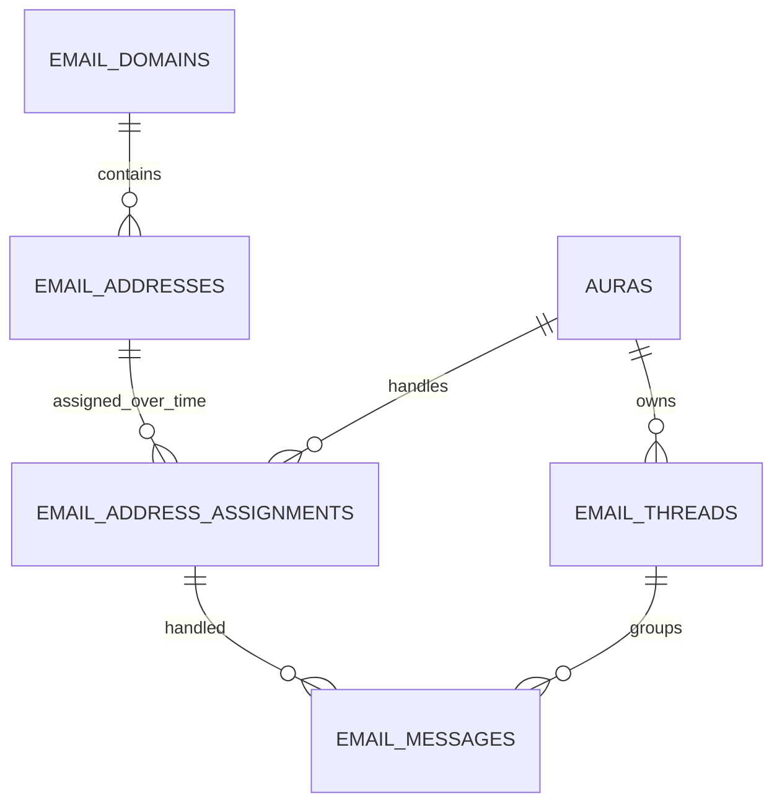
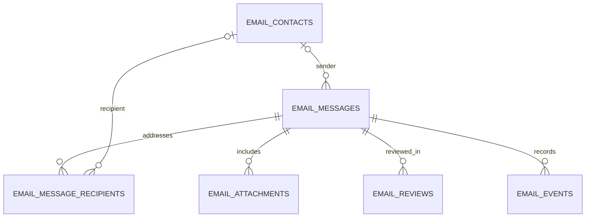

# E07: email schema and local verification

Review draft for [AXI-7](https://linear.app/34five/issue/AXI-7/e07-email-data-model-in-d1)
and [PR #3](https://github.com/34Five/AuraComms/pull/3). No Cloudflare remote database
is changed by the local tools. Pavan's approval and the confirmed target binding are
still required before integration/merge. This is a consolidated replacement for the
unmerged draft, not an upgrade for a database that already has the previous tables.

## What changed after review

The address no longer has one mutable aura_id. Its identity is stable; Aura ownership
lives in dated email_address_assignments rows. Messages reference the exact assignment
that handled them. This allows same-tenant reassignment without rewriting history.

email_domains is the registry schema requested by AXI-12. It is created before
email_addresses, which references it with `(org_id, domain_id)`. This PR adds the
data contract; AXI-12 still owns slug selection, DNS verification and provisioning
services. Do not create a competing domain registry in its later migration.

The PR also includes the previously local seed, exported parent DDL, tests and commands.
CI runs the migration/lifecycle tests on main and spikes/cf-email PRs independently
of the root package.json bootstrap guard.

## Existing parents and provenance

Intended database family: the existing Aura-layer D1 database, alongside auras and
studio_members. The dashboard evidence names aura-layer and staging databases, but
no staging UUID or approved deployment binding was supplied. config/email.local.jsonc
therefore uses a synthetic all-zero ID and is for `--local` execution only. It is
not the Cloudflare email spike's KV configuration and must not be used remotely.

Required parent keys:

| Parent | Required fields/key | Meaning |
| --- | --- | --- |
| auras | TEXT id primary/unique key, TEXT org_id | Existing Aura and tenant scope |
| studio_members | TEXT org_id, TEXT member_id, unique pair | Review actor identity |

`tests/email/fixtures/studio_parents_2026_10_22.sql` contains the exact two CREATE TABLE
statements from the user-supplied 2026-10-22 D1 sqlite_schema export, including the full
Aura definition. It is not a simplified synthetic parent schema. It contains no rows,
credentials or customer data. Its SHA-256 is recorded in parent-schema-provenance.json.
The export did not provide applied upstream migration names/versions; those remain
unknown. The preflight checks actual columns and unique keys rather than inventing a
version requirement. Newer staging schemas must be re-exported and checked for drift.

Do not run this fixture against a real existing database. This snapshot validates
compatibility with that observed schema, not proof of the current remote schema or
the behavior of Studio membership refresh/deletion.

## Relationships





| Table | Responsibility and relationship |
| --- | --- |
| email_domains | Tenant-owned default/custom domains; DNS records, provider IDs and verification state |
| email_addresses | Stable mailbox identity linked to a tenant's registered domain; lifecycle state |
| email_address_assignments | Each ownership interval, linked to an address and an Aura in the same tenant |
| email_aura_policies | Current per-Aura tier and extensible rule configuration |
| email_aura_reviewers | Designated Studio members per Aura, with revocation timestamp |
| email_contacts | Stable external address identity per tenant, optional future member/participant links |
| email_threads | Aura-scoped conversation, inbox/tier state, first-message reference and reset epoch |
| email_messages | One inbound/outbound message linked to a thread and historical address assignment |
| email_message_recipients | Ordered To/Cc/Bcc rows and recipient delivery state, optional contact reference |
| email_attachments | Message attachment metadata and R2 references |
| email_reviews | Message review revision, tier/epoch snapshot, decision actor, content hash and edit flag |
| email_events | Delivery history per message, optionally linked to one recipient |

All core relationships include org_id. A message's thread, Aura, address and assignment
must agree. Reviewers/member links cannot reference another organization's membership.
There is no authoritative organizations parent in the supplied export, so org existence
and caller access must also be validated in application code. See
[email-schema-reference.md](email-schema-reference.md) for every field, FK and index.

### Reassignment example

sales@demo.34five.studio first belongs to Sales Aura. Message M1 references assignment
A1 and a Sales Aura thread. At 10:00, close A1 and create A2 for Support Aura, using the
same address ID. Message M2 at/after 10:00 references A2 and a Support Aura thread.
M1 remains with Sales Aura. New routing uses A2; neither M1 nor its thread is moved.

Intervals are `[assigned_at, ended_at)`, using UTC RFC3339 milliseconds. Only one open
assignment per address is allowed; closed intervals cannot overlap. Assignment identity
cannot be rewritten or reopened. Closing an assignment cannot exclude existing mail.
Message activity must fall in its assignment interval. Historical delayed ingestion is
allowed when it carries the original receipt time/assignment; do not resolve it against
today's owner. Delivery events use the original message ID, regardless of reassignment.

Close the expected current assignment and insert its replacement atomically (D1 batch
or equivalent transaction), checking conflicts. Never send an old Aura's pending draft
after reassignment: the sender must recheck the active domain/address/assignment before
dispatch. Preserve, cancel or re-review drafts under the agreed service policy. Changing
an assignment does not grant the new Aura access to the old Aura's conversation history.

Current route lookup is in scripts/email/current_address.sql. It requires active domain
and address states. Domain activation checks, address creation naming, disable/deletion
workflows and provisioning remain service responsibilities (AXI-9/11/12), not triggers.
Aura deletion currently means disable, not release. Addresses remain reserved after
release; no reuse until Cassius changes that policy. Reassignment within a tenant is
different from releasing the address for a new tenant.

## Local verification

Requirements: Python 3.10+ with SQLite JSON functions. From repository root:

```bash
python3 -m unittest discover -s tests/email -v
python3 scripts/email_schema.py demo --output /tmp/aura-email-demo.sqlite
python3 scripts/email_schema.py check-parents --database /tmp/aura-email-demo.sqlite
python3 scripts/email_schema.py validate --parent-schema tests/email/fixtures/studio_parents_2026_10_22.sql
```

The demo refuses to overwrite an existing file. It creates one tenant, two Auras, one
active default domain, one pending custom-domain verification, two assignments, four
threads, six messages, reviewers, reviews, an attachment and delivery-event fixtures.
Addresses are fictional; no DNS, email or R2 objects are created. Seed R2 keys, hashes
and provider payloads are demonstration placeholders. Tier labels prefixed demo_ are
not the agreed product tier vocabulary. The SQLite seed is in scripts/email/seed.sql.

To check a newly obtained schema-only export, pass it to `validate --parent-schema`.
The check happens in memory without seed data. The check-parents command opens an
existing local SQLite database in read-only mode and verifies parent requirements.
Missing parents or existing email tables produce explicit errors before migration.

### Local D1 runtime

Use the project's installed Wrangler via the spike package (npm ci there if necessary).
The commands below use the package-pinned Wrangler and a separate local persistence
directory. Every command includes `--local`; no account/remote binding is supplied.

```bash
npm --prefix spikes/cf-email ci
node spikes/cf-email/node_modules/wrangler/bin/wrangler.js d1 execute EMAIL_DB --local --config config/email.local.jsonc --persist-to /tmp/aura-email-d1 --file tests/email/fixtures/studio_parents_2026_10_22.sql
node spikes/cf-email/node_modules/wrangler/bin/wrangler.js d1 migrations apply EMAIL_DB --local --config config/email.local.jsonc --persist-to /tmp/aura-email-d1
node spikes/cf-email/node_modules/wrangler/bin/wrangler.js d1 execute EMAIL_DB --local --config config/email.local.jsonc --persist-to /tmp/aura-email-d1 --file scripts/email/seed.sql
node spikes/cf-email/node_modules/wrangler/bin/wrangler.js d1 execute EMAIL_DB --local --config config/email.local.jsonc --persist-to /tmp/aura-email-d1 --command 'PRAGMA foreign_key_check; PRAGMA quick_check;'
node spikes/cf-email/node_modules/wrangler/bin/wrangler.js d1 execute EMAIL_DB --local --config config/email.local.jsonc --persist-to /tmp/aura-email-d1 --file tests/email/d1_reassignment_check.sql
```

Use a new local directory for a fresh run; parent fixtures and seeds are one-time
imports. migrations_dir points to scripts, where only 0001_email_model.sql is a
top-level migration. Seed/query SQL is nested and is not applied as migrations.
Wrangler tracks the applied filename in d1_migrations; do not rename applied migrations.
The last command is a one-time reassignment smoke check on the fictional seed. It
should show msg_quote_in still under Sales Aura, msg_d1_new under Support Aura, no
foreign-key violations, and quick_check = ok. See [email-validation.md](email-validation.md)
for the checks actually performed and their limitations.

For staging, first confirm the exact binding/UUID and parent migration history, then
run the reviewed migration through the real project's migration runner. Never point
the local mock config or seed at staging/production. If the earlier draft already
exists anywhere shared, stop and prepare a separate, data-preserving upgrade instead
of rerunning or dropping tables. Membership refresh/delete behavior also needs checking
because historical reviews retain member foreign keys.

## Threading, identifiers and duplicates

Generate internal message IDs before provider calls. Store canonical RFC Message-ID
and provider ID separately; missing headers are NULL. Parse/unfold RFC IDs, remove
surrounding angle brackets, preserve identifier case and References order.

Resolve the address assignment and tenant/Aura first. Check In-Reply-To within that
scope, then References right to left for the nearest known ancestor. Attach only when
known candidates identify one thread. Missing/unmatched or conflicting parents create
a new isolated thread; never merge by subject alone. Late parents are not automatically
merged in Phase 1. Thread participants are derived from sender and recipient records.
Replies after an address changes Aura do not move the old thread into the new Aura.

The adapter supplies stable ingest_key, send_idempotency_key and event dedup_key.
Inbound IDs should use verified provider delivery IDs, or a documented raw-MIME plus
envelope-destination fingerprint if none exists. RFC IDs are indexed but not assumed
unique. Outbound idempotency in D1 does not itself guarantee exactly-once provider
sending; reconcile ambiguous provider timeouts before retry. Correlate events to the
original message using verified provider IDs; buffer uncorrelated events for resolution.

## Bodies, approvals, tiers and retention

Inline text+HTML are limited to 65,536 UTF-8 bytes combined. body_size_bytes must match
the inline byte sum. Larger bodies use an R2 JSON object with text/html; size records
the combined decoded bytes. All attachment bytes use R2. Upload immutable objects before
committing references and clean up orphans when writes fail. R2 and D1 are not atomic.
Choose a dedicated bucket/approved prefix with the team; the intelligence bucket is not
assumed. Keep Bcc and raw MIME restricted to authorized views and sanitize rendered HTML.

Review status, submission status and recipient delivery state are separate. A sent
message can subsequently bounce. Events preserve native category, occurrence/ingestion
times and raw JSON; payloads above 64 KiB use R2. Event reducers must handle replay and
out-of-order delivery. No send/event reducer is implemented by this schema.

Approvals use current designated per-Aura reviewers, not conversation initiators by
default. Services check active reviewer membership/access when deciding. Hash the exact
approved body, recipients, attachment references and relevant headers; edits invalidate
the decision. On reset, increment thread review_epoch/state_version and supersede stale
reviews atomically. Before sending, compare epoch, content and active routing assignment.
The final tier vocabulary, first-reply/reset rules and reviewer revocation policy remain
AXI-8 decisions. rules_json is an extension point, not an evaluator or recipient allowlist.

Phase 2 reserves attachment extraction status/text reference/error/time (E27), reply
recipient decision/reason/time (E28), and stable contacts with nullable member and
participant links (E25/E26). No matching, memory sync or extraction runs in Phase 1.

Foreign keys restrict deletion. Retention must follow the agreed org_settings policy:
clear thread first_message_id, remove child events/reviews/attachments/recipients, then
messages/threads and unneeded assignments/contacts/addresses. R2 cleanup is retryable
service work. Anonymization/tombstones for member deletion need an explicit agreement.

## Query and index notes

Thread indexes support org/Aura/date, inbox state/date and tier/date; org/date supports
all-Aura views. Message indexes support direction/status/date, thread traversal, assignment
history and RFC/provider correlation. Review queues and event analytics have separate
indexes. scripts/email/inbox.sql shows combined filters and keyset pagination. Omit
unused filters rather than OR-ing every nullable parameter. Bind org_id from authenticated
context. Validate plans against staging volumes before multiplying composite indexes.

## References

- [AXI-9 lifecycle](https://linear.app/34five/issue/AXI-9/e02-address-lifecycle-service)
- [AXI-12 domain registry](https://linear.app/34five/issue/AXI-12/e03-e04-tenant-domain-registry-default-subdomain-and-custom-domains)
- [D1 migrations](https://developers.cloudflare.com/d1/reference/migrations/)
- [Local D1 development](https://developers.cloudflare.com/d1/best-practices/local-development/)
